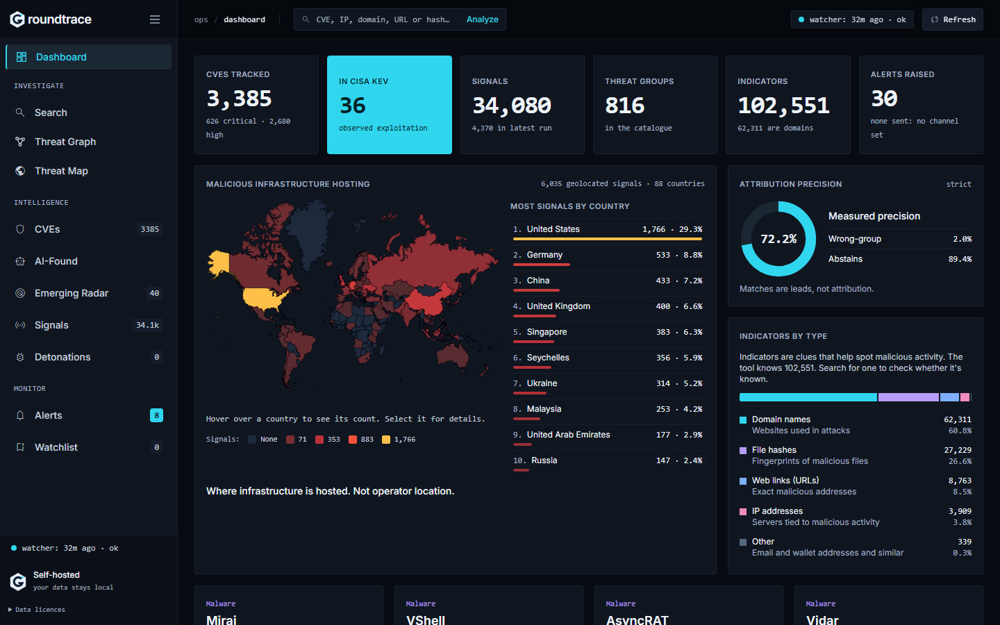
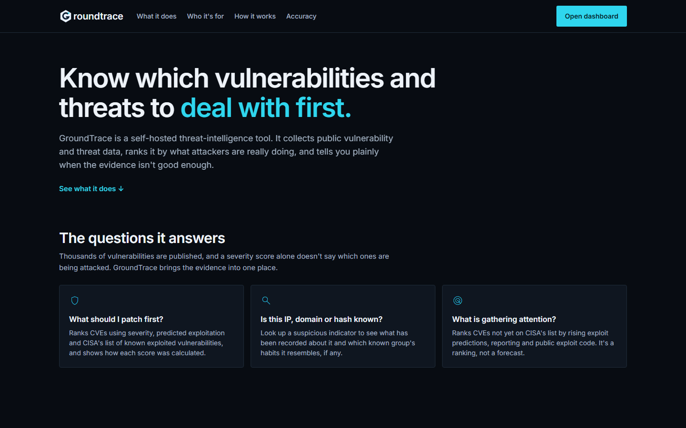
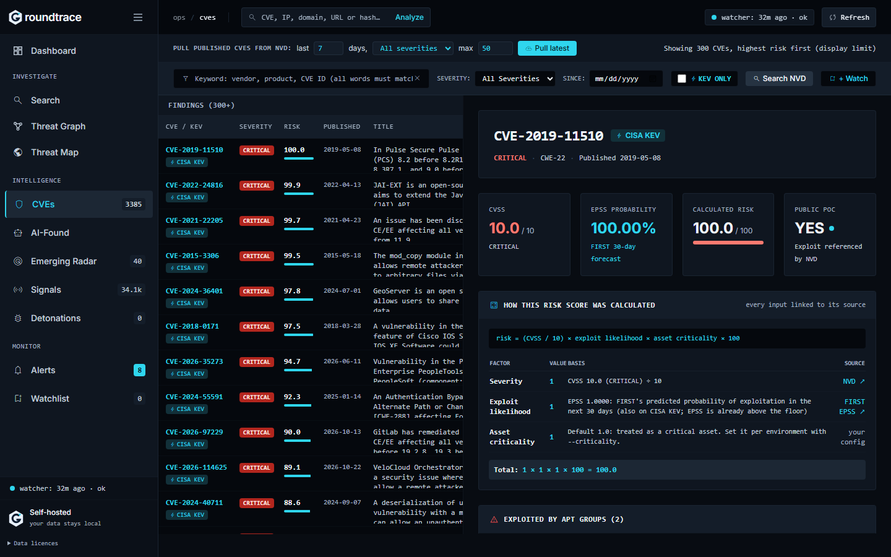
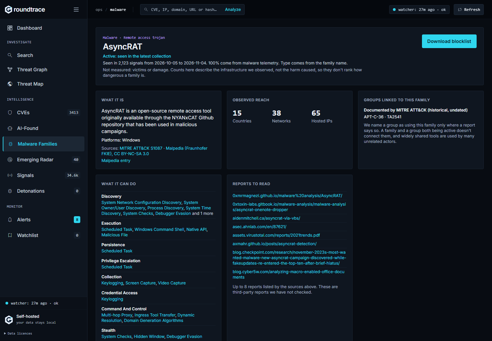
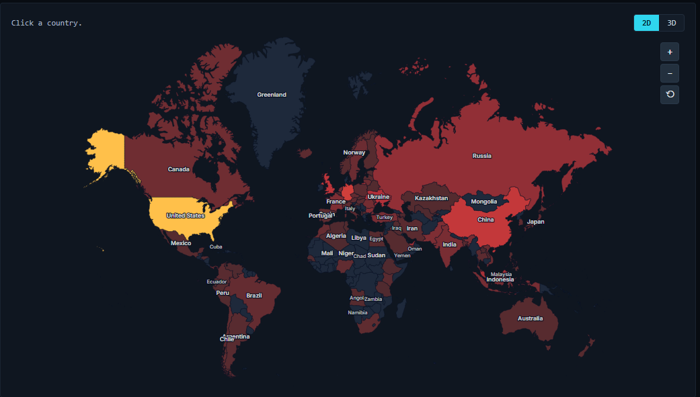
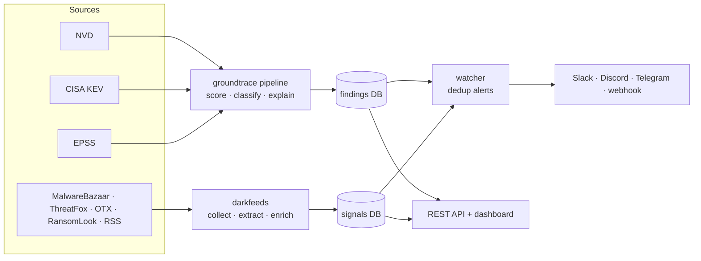

# GroundTrace

[](https://github.com/LashariSain/Groundtrace/actions/workflows/ci.yml)
[](#how-accurate-is-it-and-how-do-you-know)
[](#development)
[](#quick-start)
[](LICENSE)

**A threat-intelligence tool that publishes its own error rate.**

GroundTrace prioritises CVEs by real-world exploitation, and matches unattributed
infrastructure to the groups whose habits it resembles. The second part is the one
worth checking, so here is how often it is right:

| Mode | Top-1 precision | Wrong-group rate | Abstains | Method |
|---|---|---|---|---|
| **strict** (default) | **72.2%** | 2.0% | 89.4% | two independent habits must agree |
| **broad** (hunting) | **69.5%** | 6.8% | 66.7% | one rare habit, labelled a lead |

Measured by leave-one-out over the stored catalogue: 867 tests, 29 held-out groups,
max 15/group, macro-averaged so no single large group sets the figure. Reproduce it
yourself:

```bash
python scripts/validate_footprints.py --sweep
```

That command prints the whole threshold curve and exits non-zero if strict precision
falls below 0.60. The numbers in this README, in the API responses and on the
dashboard all come from it — nothing is estimated, and no result carries a reliability
figure that has not been measured.

**It abstains.** At the default threshold the matcher declines to name a group almost
nine times in ten. That is the intended behaviour: "insufficient evidence" is a
correct answer, and a tool that always answers is one you cannot trust when it does.

Pure Python standard library + SQLite. No framework, no external services required to
start, one small Docker image.

## Screenshots

The home page is at `/` and the dashboard at `/dashboard`.



| Home | CVE detail |
|---|---|
|  |  |





---

## What it does

| | |
|---|---|
| **Prioritise** | Every CVE is scored on CVSS × EPSS (exploit probability) × asset criticality, with CISA KEV (confirmed exploitation) taken into account. A 9.8 nobody exploits ranks below a 7.5 that's being used in the wild. |
| **Explain** | Each CVE gets a five-part analysis: what it is, the root cause (CWE-driven), how it was found and how it went public, business impact, and the security principle it violates. |
| **Correlate** | Collects threat-intel signals (MalwareBazaar, ThreatFox, AlienVault OTX, RansomLook, security news) and joins them to CVEs, so a CVE's page shows the underground activity tied to it. |
| **Find PoCs** | Lists public exploits for a CVE (PoC-in-GitHub index, GitHub search, Exploit-DB/Packet Storm/Metasploit references) with red flags for repos that look like malware lures. Links only: nothing is downloaded or run. |
| **Map** | A threat map built from the hosting country, ASN and provider of every malicious IP, plus actor attribution — with written findings, e.g. which single provider hosts most of a country's attack infrastructure. |
| **Search & watch** | Keyword search over CVE id, title, description and affected vendor/product (every word must match), with one click to pull the newest matching CVEs from NVD. Save a keyword ("geoserver", "fortinet fortios") to a watchlist and the watcher alerts on each new matching CVE. |
| **Alert** | A scheduled watcher alerts on new KEV entries, watchlist matches, CVEs appearing in underground sources and high-priority signals — to Slack, Discord, Telegram or any webhook. Deduplicated, so a restart never re-alerts. |

## What makes it different

- **It publishes its own error rate, and you can reproduce it.** One command prints
  the precision of every threshold, on a held-out half of the catalogue the thresholds
  were never tuned against. See [How accurate is it](#how-accurate-is-it-and-how-do-you-know).
- **It abstains.** "Insufficient evidence" is a first-class answer, returned roughly
  nine times in ten at the default threshold, rather than a weak guess dressed up with
  a confidence percentage.
- **Provenance, not just severity.** It classifies *how* a flaw was discovered
  (fuzzing, bug bounty, exploited in the wild, …) and *on what basis* it went public
  (coordinated disclosure, exploit published, zero-day leak), and flags flaws that were
  public before a patch existed. Every label records the exact phrase or URL that
  justified it.
- **Exploitation-aware risk.** EPSS is a *prediction*; a KEV listing is *observed*
  exploitation. GroundTrace treats them differently instead of averaging them away
  (see [How the risk score works](#how-the-risk-score-works)).
- **Honest geography.** CVEs have no location. The map shows where attack
  infrastructure is *hosted*, separates rented cloud servers from infected consumer
  devices, and says so on the page.
- **Pre-disclosure awareness.** Look up a CVE that NVD hasn't published yet and it
  checks the CVE.org registry, tells you whether the ID is reserved, and falls back to
  a web search for vendor write-ups and early reporting.
- **No required dependencies.** Runs on the Python standard library. Two optional
  extras exist: `certifi` widens the set of trusted certificate authorities (some
  threat-intel APIs are signed by CAs absent from a system trust store; without it
  those lookups report an error rather than a wrong answer), and the experimental Tor
  crawler has its own requirements file. The Docker image includes `certifi`.

---

## How accurate is it, and how do you know?

Almost no open-source threat-intel tool publishes its own accuracy. This one does,
because a claim you cannot check is not intelligence.

### The method

`scripts/validate_footprints.py` runs leave-one-out over the stored indicator
catalogue. For each test indicator, its own group's footprint is rebuilt *without*
that indicator, every other group's footprint is left alone, and the indicator is then
matched against all of them. A match counts as correct only when the top-ranked group
is the one the indicator actually belongs to.

Two details stop the number flattering itself:

- **The catalogue is split.** Groups are divided by a hash of their key. The *fit* half
  is the only part a threshold may be tuned against; the *report* half is untouched and
  is the only source of a published figure. Choosing a threshold by looking at results
  and then quoting those same results as its precision inflates the number.
- **Tests are capped per group, and the headline is macro-averaged.** One "group" in
  the catalogue — a phishing-as-a-service platform — holds 42,193 of 56,624 indicators.
  A uniform sample is therefore mostly that one feed, whose thousands of unrelated
  customer domains share no habits. Pooled precision is 25.2% on its indicators alone,
  33.1% on a uniform catalogue sample, and 55.7% with it excluded. Quoting the uniform
  figure would describe that feed rather than the matcher.

### The full curve

Report half, 867 tests, macro-averaged over groups:

| Threshold | Surfaced | Macro precision | Micro | Wrong-group | Abstains |
|---|---|---|---|---|---|
| 2.5 (broad) | 289 | 69.5% | 79.6% | 6.8% | 66.7% |
| 3.0 (strict) | 92 | 72.2% | 81.5% | 2.0% | 89.4% |
| 3.5 | 85 | 82.4% | 88.2% | 1.2% | 90.2% |
| 4.0 | 68 | 82.6% | 89.7% | 0.8% | 92.2% |
| 5.0 | 30 | 93.3% | 96.7% | 0.1% | 96.5% |

Precision rises as coverage falls; that trade-off is published rather than hidden
behind a single chosen number.

### What this number does *not* cover

- **It measures resemblance, not attribution.** A match says an indicator shares
  infrastructure habits with a group. It never says who operated it. Every result is
  labelled `verdict: "lead"` for this reason.
- **The strict figure rests on 92 matches across 29 held-out groups.** That is thin.
  Treat it as an order of magnitude, not a precise constant.
- **99% of catalogue footprints carry no dates**, because the write-ups they come from
  publish none. The measurement was taken on exactly that population, so it describes
  it — but a footprint that is *demonstrably* stale caps reliability at 0.45, and says
  that the cap is a judgement rather than a measurement.
- **Nothing else in the tool carries a measured accuracy.** The CVE risk score is a
  stated formula, not a prediction; the radar ranks and explains but deliberately makes
  no forecast (see below).

### Other places the tool refuses to overclaim

- **No pseudo-confidence.** An earlier version derived a confidence percentage from a
  match's own score. It read as authoritative while measuring nothing, and it is gone.
- **"Confirmed" requires two sources.** Indicator verification reports `sources` and
  `corroborated` on every verdict, and reserves "confirmed" for two or more independent
  services agreeing. VirusTotal counts once, however many engines it aggregates.
- **A failed lookup is never reported as a clean result.** If a source cannot be
  reached, the result says so instead of silently reading as "not found".
- **The radar makes no prediction.** It previously sorted CVEs into hot/warming bands
  at 60 and 40 out of 100. Those thresholds were invented, not fitted against
  historical outcomes, so the bands were removed. It now ranks and explains, and alerts
  only on checkable facts — a PoC predating NVD publication, EPSS at or above 0.9 while
  absent from KEV, or a 7-day EPSS rise of at least 0.05.
- **Every claim is recorded and nothing is edited.** `groundtrace/claims.py` is an
  append-only ledger: what was claimed, the evidence, the measured reliability, and
  what would prove it wrong. Corrections insert a new row and supersede the old one.
  Immutability is enforced by SQLite triggers, not by convention.

---

## Quick start

### Docker (dashboard + scheduled watcher)

```bash
cp .env.example .env          # set GROUNDTRACE_API_KEY to a long random value
docker compose up -d --build
# open http://127.0.0.1:8080/
```

The port is published on `127.0.0.1` only. The API refuses to bind to a network
interface unless `GROUNDTRACE_API_KEY` is set.

### Local (Python 3.12+)

```bash
python -m groundtrace demo                       # offline sample, no network
python -m groundtrace cve CVE-2021-44228         # live: NVD + CISA KEV + EPSS
python -m groundtrace serve                      # home at http://127.0.0.1:8080/, dashboard at /dashboard
```

No API keys are needed to start. NVD, KEV, EPSS and RansomLook work without one; keys
unlock more sources (below).

---

## Configuration

Copy `.env.example` to `.env`. Every key is optional; each one unlocks something.

| Variable | Unlocks |
|---|---|
| `GROUNDTRACE_API_KEY` | Required to expose the API/dashboard beyond localhost (sent as `X-API-Key`). |
| `GROUNDTRACE_NVD_API_KEY` | NVD rate limit 5 → 50 requests / 30 s. ([request one](https://nvd.nist.gov/developers/request-an-api-key)) |
| `DARKFEEDS_ABUSECH_KEY` | MalwareBazaar + ThreatFox malware and IOC feeds. ([auth.abuse.ch](https://auth.abuse.ch/)) |
| `GROUNDTRACE_MAP_3D` | Set to `1` for the 3D globe without any map account — NASA Blue Marble imagery (public domain). Off by default so the default build makes no third-party requests. |
| `ARCGIS_API_KEY` | Optional. Esri satellite imagery for the 3D globe instead of Blue Marble, and turns 3D on by itself. Needs an **ArcGIS Location Platform** account — a free ArcGIS Online / public account cannot issue API keys. |
| `HYBRIDANALYSIS_API_KEY` | Hybrid Analysis / Falcon Sandbox — per-detonation network indicators and a 24h sample feed. Free key on a registered account. ([hybrid-analysis.com](https://www.hybrid-analysis.com/)) |
| `ANYRUN_API_KEY` | Optional. ANY.RUN sandbox task feed — **paid tiers only**, a free Community account gets no key. Without it, fresh-sample discovery falls back to MalwareBazaar and capture uses VirusTotal. |
| `DARKFEEDS_OTX_KEY` | AlienVault OTX pulses — the main source of CVE ↔ threat correlation. |
| `DARKFEEDS_VT_KEY` | VirusTotal reputation for collected hashes. |
| `DARKFEEDS_SHODAN_KEY` | Shodan host/service enrichment of collected IPs. |
| `GROUNDTRACE_GITHUB_TOKEN` | GitHub search for the PoC finder: 10 → 30 searches/min. A token with no scopes is enough. |
| `GROUNDTRACE_WEBHOOK_URL` | Alert delivery (Slack and Discord payloads detected from the URL). |
| `GROUNDTRACE_TELEGRAM_BOT_TOKEN`, `GROUNDTRACE_TELEGRAM_CHAT_ID` | Alert delivery to Telegram. |

**Until one of those is set, no alert leaves the machine.** The watcher still
runs, still records every alert, and the dashboard and `GET /alerts` still show
them — but nothing is sent anywhere, and an unconfigured watcher looks exactly
like a quiet week. `GET /metrics` reports `alert_channels` so the state is
visible rather than silent, and the watcher logs it on every cycle that would
have sent something.

The quickest channel to set up is a Slack or Discord incoming webhook; paste the
URL into `GROUNDTRACE_WEBHOOK_URL` and the payload format is detected from it.
| `GROUNDTRACE_LLM_PROVIDER` | Optional model-written summaries (`offline` by default — nothing is sent anywhere). |

`.env` is git-ignored. Never put real values in `.env.example`.

---

## Using it

**Dashboard** (`python -m groundtrace serve`): findings ranked by risk, CVE detail with
scores, analysis, underground activity and score history; "Pull latest" for newly
published CVEs; the threat map; recent alerts.

**CLI**

```bash
python -m groundtrace recent --days 7 --min-severity HIGH   # pull + store recent CVEs
python -m groundtrace query fortinet --kev                  # search the local store
python -m groundtrace show CVE-2024-3400                    # full record + score history
python -m groundtrace unified CVE-2024-3400                 # CVE + underground signals
python -m groundtrace watch --once                          # one collection/alert cycle
python -m groundtrace alerts                                # what has been sent

python -m darkfeeds.cli collect                          # collect threat-intel signals
python -m darkfeeds.cli stats
```

**REST API** — all JSON; full list in [`groundtrace/api.py`](groundtrace/api.py).

| Endpoint | |
|---|---|
| `GET /findings?severity=&kev=1&since=&min_risk=&q=` | Search stored CVEs |
| `GET /findings/<CVE>` | Full record, score history, underground signals |
| `POST /analyze/<CVE>` | Live analysis, saved to the store |
| `POST /recent?days=&min_severity=` | Pull newly published CVEs |
| `POST /search/nvd?q=&days=` | Pull the newest NVD CVEs matching a keyword |
| `GET`/`POST`/`DELETE /watchlist?term=` | Keywords the watcher alerts on |
| `GET /pocs/<CVE>` | Public PoC links with red flags (never downloaded) |
| `GET /signals`, `GET /geo` | Threat-intel signals; threat-map data |
| `GET /metrics`, `GET /health` | Watcher status and per-step errors; liveness |

---

## How the risk score works

```
risk = (CVSS / 10) × exploit_likelihood × asset_criticality × 100
exploit_likelihood = EPSS            (0.1 if EPSS is unknown)
                   = max(EPSS, 0.9)  if the CVE is on CISA KEV
```

A KEV listing means exploitation has been observed, so it floors the exploit
likelihood rather than letting a low EPSS forecast pull an actively exploited CVE
down. `asset_criticality` (0–1) is yours to set per environment
(`--criticality 0.9`). CVEs with no CVSS yet have no risk score rather than a guessed
one.

## Data sources

| Source | Used for | Key |
|---|---|---|
| [NVD](https://nvd.nist.gov/) 2.0 API | CVE record, CWE, CVSS, references | optional |
| [CISA KEV](https://www.cisa.gov/known-exploited-vulnerabilities-catalog) | Confirmed exploitation | — |
| [FIRST EPSS](https://www.first.org/epss/) | Exploit probability | — |
| [CVE.org](https://www.cve.org/) registry | Reserved / not-yet-published CVEs | — |
| [MalwareBazaar](https://bazaar.abuse.ch/), [ThreatFox](https://threatfox.abuse.ch/) | Malware samples, IOCs, C2 infrastructure | abuse.ch |
| [AlienVault OTX](https://otx.alienvault.com/) | Threat pulses, CVE ↔ actor links | OTX |
| [RansomLook](https://www.ransomlook.io/) | Ransomware leak-site claims | — |
| RDAP + [Team Cymru](https://www.team-cymru.com/ip-asn-mapping) | IP → country / ASN / provider | — |
| Security news RSS | Early reporting | — |
| [Malpedia](https://malpedia.caad.fkie.fraunhofer.de/) | Malware family descriptions, aliases, attribution, reports. CC BY-NC-SA 3.0, so **non-commercial**. Downloaded to your machine, not shipped; set `GROUNDTRACE_MALPEDIA=0` to leave it out | — |
| [MISP Galaxy](https://github.com/MISP/misp-galaxy) | Malware family descriptions and reports (CC0 or BSD) | — |

---

## Architecture



```
groundtrace/    CVE engine: feeds, scoring, provenance classifiers, report, store,
             API + dashboard, watcher, alerts, threat map
darkfeeds/   threat-intel collectors, IOC extraction, IP/hash enrichment, signal store
tests/       offline test suite (no network)
```

---

## Limitations and responsible use

- **Only footprint matching has a measured accuracy.** The published precision covers
  that one capability. Nothing else in the tool carries a measured error rate, and no
  other output should be read as if it did.
- **A footprint match is a lead, never an attribution.** It says an indicator shares
  infrastructure habits with a group; it says nothing about who operated it. The
  measured figure describes how often the top-ranked group is the right one, on this
  catalogue, at a stated threshold.
- **Provenance and root-cause labels are heuristic.** They cite their evidence;
  verify before publishing research.
- **Infrastructure location is not attribution.** A country hosting C2 servers is
  where attackers rent infrastructure, not necessarily where they are. Actor-origin
  attribution comes from a curated, best-effort mapping.
- **Collection is passive.** GroundTrace reads public feeds and APIs; it does not
  scan, probe or interact with targets.
- **The Tor crawler is experimental and off by default.** It needs a separate install
  (`requirements-crawler.txt`, or `docker compose --profile crawler up`) and a Tor
  service. Check the law and your organisation's policy before using it.
- **Use exploit lookups for defence and research.** They list links only, and nothing
  is downloaded or run. Only test systems you are authorised to test.
- **Review blocklists before using them.** Indicators can be wrong or out of date, and
  old infrastructure can be reassigned to innocent owners.
- **Malpedia data is non-commercial** (CC BY-NC-SA 3.0). For commercial use, set
  `GROUNDTRACE_MALPEDIA=0` or get permission.
- **Free-tier rate limits are respected** (per-source throttling and a daily request
  cap), so large pulls are deliberately slow.

## Development

```bash
pip install -r requirements-dev.txt
python -m pytest -q                                   # offline test suite
ruff check groundtrace darkfeeds tests --select E9,F     # what CI runs

python scripts/validate_footprints.py --sweep         # measure match precision
python scripts/validate_footprints.py --all           # every indicator (slow)
```

`validate_footprints.py` is the only supported way to change the reliability figures
in `groundtrace/fingerprint.py`. It exits non-zero if strict precision falls below 0.60,
so an accuracy claim cannot quietly rot.

CI (GitHub Actions) runs lint, a byte-compile and the tests on Python 3.12 and 3.13,
and checks that the Docker image builds. See [CHANGELOG.md](CHANGELOG.md) for release
history and [SECURITY.md](SECURITY.md) to report a vulnerability.

## License

[MIT](LICENSE) © 2026 M Kazim Abbas Lashari
